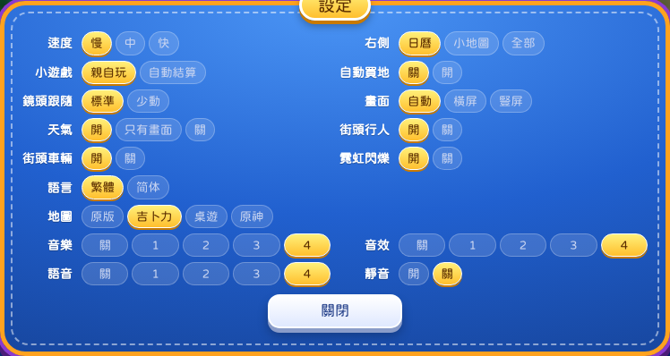

# 2026-10-26 · 选择性同步上游 v0.7.8

本次在 `sync/upstream-v0.7.8-web` 移植 P0 稳定性与 P1 Web 体验修复，保持 Web Fork 的规则、存档和基础设施。**不批准生产发布，不更新 VPS 长测环境。**

## 来源与范围

- Web 基线：`b0dd370`（包版本 `0.7.1`）。
- 上次共同基线：`19c12ec`；上游目标：`v0.7.8 / 4795342`。
- 获取远端后确认为 Web 独立 45、上游独立 23 个提交。未合并整个上游分支，也未将包版本标成完整 v0.7.8。

| 批次 | 上游来源 | 本次行为 |
| --- | --- | --- |
| P0 文本稳定性 | `c940a25`，以及其修复所针对的 `72070c0` 文案 | `lang.ts` 跳过自己的转换结果；`jq-theme.ts` 的建设公司费用及时代改名收敛，避免简体转换与主题观察器互相触发；保留神婆文案幂等修复 |
| P0 动画恢复 | `c940a25` | 事件、镜头、轮盘和老虎机加入前台时间超时及清理；后台时间不计入等待；为本项目额外加入取消，防止房主答案或回合期限已生效后旧守卫误关下一张弹窗 |
| P0 联机保护 | `a0bd95f` 的双向版本拒绝思路 | 适配现有 Web 协议，独立校验协议／规则；覆盖加入、房主大厅、开局、重连日志及旧房主拒绝提示；未覆盖替换整个 `party-net.ts` |
| P0 骰子选择 | `94dd72c` | 同一回合打开／取消卡片、道具、股市后保持已选骰子数；实际掷骰仍由现有引擎约束 |
| P1 iPad 画面 | `5440d2b` | 贴图解码失败在 2–30 秒退避后重试；Canvas 定期检查布局尺寸与 DPR，调整时继续调用现有 WebGL resize；补充 PingFang TC 字体回退和竖屏新局间距 |
| P1 镜头 | `d4b2af0` 的镜头部分 | 对话框真正遮挡人物时才偏移镜头，延迟复位；新增“镜头跟随：标准／少动”设置，保留默认标准模式 |
| P1 设置、声音 | `083dcfe`、`fa85199` | 平板与手机双列设置；Web Audio 中断时有限重试，在恢复或下一次手势中重建上下文；保留 CDN URL 重写与原有曲目 |

没有同步：岔路 LRU、规则／数值平衡、新卡片与事件、新音乐、手柄／键盘导航、Android／Electron／Capacitor 代码、`fflate` 或原生存档压缩、公共 STUN/TURN 替换。

## 兼容性与回滚

- **核心规则及存档 schema 未改变**，`core/`、`saves.ts`、包依赖、部署配置与 PWA Worker 实现无修改。
- 协议从 `1` 升为 `2`：大厅及重连日志必须携带版本，新旧客户端不能混用。新版本也拒绝未提供版本的房主和加入者。
- 规则标识从陈旧的 `0.6.6` 改为 `web-v0.7.1`。旧标识在 v0.7.1 规则合并后未更新；新标识明确表示此 Web 规则基线，不表示引入 v0.7.2 的岔路规则。
- 同一房间必须全员刷新至新版本。运行中的旧长测房间继续用原部署；新分支只适合独立预览，不做进行中对局的滚动升级。
- 回滚以 `b0dd370` 为基线恢复整批代码；存档数据无需降级转换。回滚房间中的所有客户端也必须使用同一协议。
- 私有素材包未下载或更新。本次未增加素材 URL，审计只证明本机现有素材闭合，不能证明已安装上游 10 月 26 日的新素材包。

## 代码审核

使用 `pm-ai-shipping:code-review`，维度为正确性；比较基线 `b0dd370`，范围为全部工作区改动及调用依赖。审核按数据与状态流检查，不将编译通过视为无缺陷证明。

已检查并修正：

1. **超时与权威答案的生命周期**：联机 `timed()` 可以先接受房主答案或托管结果，原 `hud.ask()` 仍未结束；直接移植的守卫会稍后运行全局弹窗清理。新增 `AbortSignal` 在本次问题结束时撤销守卫；真正取消轮盘／老虎机时关闭其帧循环并结清等待；守卫超时记录也不再永久留在诊断列表。
2. **加入者／房主版本约定**：原实现只对可选 `hi.proto` 做比较，发送的 `rules` 未参与拒绝，房主的大厅／开局／重连日志未对称验证。现实现拒绝缺失或不一致的版本，在登记座位、消费重放前检查；沿用令牌认证、座位授权、房主答案回显与受控 TURN。
3. **连接身份与异步顺序**：构造两个连接，先接受新连接再迟到旧连接的大厅包。旧连接不得改写新连接状态，旧连接超时也不得关闭新连接；加入回归测试。
4. **旧房主拒绝的消费者**：旧 Web 房主只发送文字“版本不一致”，没有新标志。兼容此拒绝，避免房主移交后已终止的连接只显示等待条。
5. **实际选择与引擎约束**：保持 GO 选择时沿用现有 `maxDice` 钳制；缓存按玩家与回合区分，不改引擎随机流。
6. **渲染及声音所有权**：尺寸恢复仍通过现有 Canvas/WebGL resize 与回退入口；音频仅在当前上下文收到状态事件时恢复，主动后台挂起不当作 Siri 中断；CDN 路径保留。
7. **存档测试约定**：v0.7.1 已存在 UI 读档重新洗骰，旧 E2E 仍比较 RNG 全等。更新共享断言，仅允许 `rng` 与 `rngSalt` 的预期变化，其余设置、玩家、棋盘、模块与统计完整比较；渲染器上下文丢失前后仍要求整个恢复后的状态完全相等。WebKit 可能不提供 `getContextAttributes().alpha`，测试以采样像素的实际透明度为准，未降低合成画面与回退检查的阈值。

以上问题修正后，在所审查范围内没有剩余的已证实阻断缺陷。代码审核未单独执行性能或安全专项审计；没有宣称代码无缺陷，也没有实测冷启动性能提升。

## 自动化验证

环境：本地 macOS、Node.js `v22.23.4`；使用本机已有私有素材。命令均从 `game/` 执行。最终结果见本节更新与证据目录。

| 检查 | 结果 |
| --- | --- |
| `npm test` | 73 文件、609 项通过；0 跳过 |
| `npx tsc --noEmit` | 通过 |
| `RICH4_NO_ASSETS=1 npm run build:web` | 通过 |
| `npm run verify:web:code` | 20 项通过；明确为代码构建验证 |
| `npm run test:e2e:code` | 桌面、移动 Chromium 共 6 项通过 |
| `npm run audit:assets` | 37,297 引用文件，1,690.37 MiB，0 缺失；shell 54 文件、7.37 MiB |
| `npm run verify:web` | 本地挂载现有素材后 20 项通过，含 SHA-256 全量内容完整性；不是远端发布验收 |
| 桌面完整素材回归 | 存档 2 项、渲染器 2 项、上游修复 4 项通过 |
| 本地真实 Nginx A→B→A | 首轮 B→A 时 Worker 在 installed 等待超时；不修改 Worker 的独立复测通过。记录为一次间歇性失败，不能用重试抹去 |
| 最终跨浏览器回归 | 桌面 Chromium、移动 Chromium、WebKit 共 24 个场景均已通过。首轮 23/24；WebKit 的 `getContextAttributes().alpha` 未提供字段导致断言失败，改为保留实际像素透明度检查后，WebKit 渲染器 2 项独立复测通过 |

浏览器命令：

```bash
E2E_WEBKIT=1 npx playwright test tests/e2e/upstream-sync.spec.ts \
  tests/e2e/full-gameplay.spec.ts tests/e2e/renderer-composition.spec.ts \
  --project=desktop-chrome --project=mobile-chrome --project=ios-webkit

NGINX_BIN=<本地nginx> NGINX_MIME_TYPES=<mime.types> E2E_NGINX=1 \
  npx playwright test tests/e2e/release-cycle.spec.ts --project=desktop-chrome
```

Nginx 用例生成同一候选构建的 A/B 两套独立入口哈希，验证 Worker 更新、回滚、缓存清理和 UI 存档保留；没有冒充真实历史生产构建升级。设置布局截图（仅设置窗口，无私有地图／角色图像）：



浏览器媒体及画面截图保留在忽略的 `game/test-results/`，不提交私有地图／人物截图。

## 发布前仍需人工验收

- [ ] 三台实体设备至少 20 次有效规则操作，逐端比较摘要；包含跨 NAT／TURN 和断网重连。
- [ ] iPad Pro A12Z / Safari 的长测、Siri／系统音频中断、后台恢复、解码内存压力及实际声画观察。
- [ ] 真实历史部署／旧 PWA 和历史真实存档的升级及回退复核，跟踪本次 Worker 等待超时。
- [ ] 若之后同步新内容或音乐，单独核对新素材包并重新生成资源摘要。
- [ ] 独立预览环境和实体设备验收通过后再决定发布；当前 VPS 长测部署未操作。
